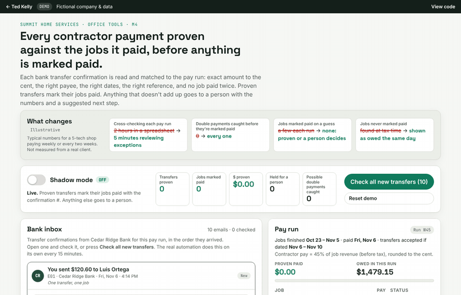
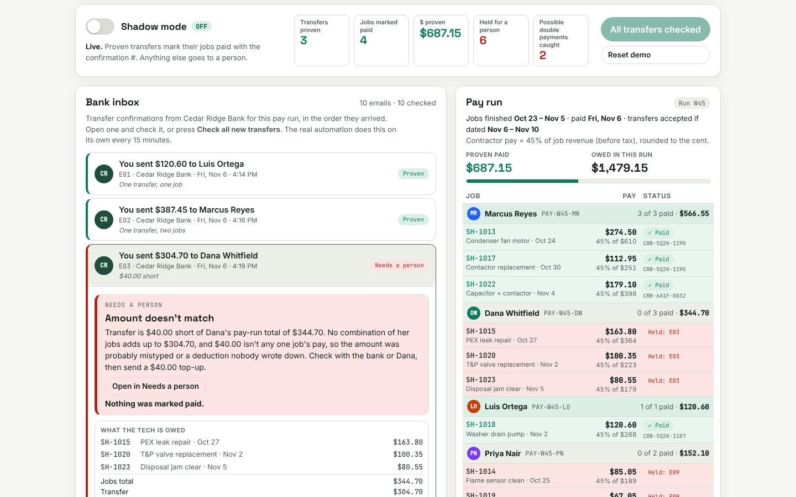

# Payment Proofing (M4)

Every contractor bank transfer is matched to the jobs it paid (exact amount, right payee, right dates) before anything is marked paid. Mismatches and possible double payments go to a person.

**Try it:** https://tedkelly.dev/projects/payment-proofing/



## The problem

Paying contractors takes hours and mistakes happen.

Summit pays its technicians per completed job, by bank transfer, in a pay run every two weeks. Each transfer produces a confirmation email from the bank: "You sent $387.45 to Marcus Reyes · ref PAY-W45-MR · Nov 6". Then someone in the office opens a spreadsheet and cross-checks every email against the jobs by hand. Which jobs did that $387.45 cover? Was it the right amount? Did Jake's transfer go to Jake? Two hours later the spreadsheet is mostly right. Jobs still get paid twice, an amount is $40 off and nobody notices, and some jobs are never marked paid at all, so the books don't match at tax time.

## What it does

- **Builds the pay run** from the jobs sheet: every job a tech finished in the period, the pay for each (45% of job revenue in the demo, shown on the page), each tech's total and the reference the transfer should carry (`PAY-W45-MR`).
- **Reads each bank confirmation email**: amount, payee, masked account, reference, date, memo and confirmation #. It reads the bank's normal format and a forwarded receipt.
- **Proves it against the pay run** with six checks, each shown as pass or fail with a plain-English reason: payee, amount exact to the cent, date inside the pay window, reference, no job paid twice, every job belongs to that tech.
- **Proven:** the jobs are marked paid with the transfer ref and confirmation #, and the pay-run rows turn green. One transfer can cover several jobs; it finds the one set of jobs whose pay adds up to the amount exactly.
- **Not proven: Needs a person**, with the email, the jobs it might cover, the difference and a suggested next step, for example: "Transfer is $40.00 short of Dana's pay-run total of $344.70 … Check with the bank or Dana, then send a $40.00 top-up." A person approves it with a note, rejects it, or fixes what was read and re-runs the checks.

The demo's bank inbox has ten emails for one pay run, built from the shared Summit jobs:

| Email | Case | Result |
|---|---|---|
| E01 | One transfer, one job | Proven |
| E02 | One transfer, two jobs, no memo | Proven by summing SH-1013 + SH-1017 |
| E03 | $40.00 short | Needs a person |
| E04 | Same payee, amount and ref sent twice | Needs a person: possible double payment |
| E05 | "Jake Moore", a different account | Needs a person: wrong payee |
| E06 | Memo lists a job paid in an earlier run | Needs a person: possible double payment |
| E07 | A supplier payment in the bank label | Needs a person: no matching pay-run line |
| E08 | "M. Reyes" | Proven (known name for Marcus Reyes) |
| E09 | Forwarded receipt dated before the work was done | Needs a person: outside the date window |
| E10 | The bank re-sent E02's confirmation | Skipped, not paid twice |

## Before and after

| | Before | After |
|---|---|---|
| Cross-checking each pay run | 2 hours in a spreadsheet | 5 minutes reviewing exceptions |
| Double payments caught before they're marked paid | 0 | every one |
| Jobs marked paid on a guess | a few each run | none: proven, or a person decides |
| Jobs never marked paid | found at tax time | shown as owed the same day |

These numbers are illustrative, for a 5-tech shop. They are not measured from a real client.

## The safety rules it follows

1. **Shadow mode first.** On a first visit every transfer is checked but nothing is marked paid. The log says what it would do: "WOULD mark SH-1013 and SH-1017 paid", "WOULD send to a person". In a real install you run it beside the spreadsheet for a pay run or two, compare, then switch it on.
2. **Exact to the cent.** Money is whole cents (integers), never floating-point dollars. A transfer must equal the pay for the jobs it covers exactly. One cent off goes to a person with the difference.
3. **Right payee.** The name must be the tech or a name in the known-names table ("M. Reyes" is Marcus Reyes), and the masked account must be the saved one. A different name never matches, however close.
4. **Right dates, right reference.** The transfer must be dated inside the pay run's window and carry that tech's reference.
5. **No job paid twice.** A job can be proven paid once. A second transfer with the same payee, amount and reference, or a job already paid in an earlier run, is flagged as a possible double payment.
6. **Never on a guess.** Without job numbers in the memo, it finds the set of jobs whose pay adds up to the amount. If none does, or two different sets do, it stops and asks.
7. **Same email, once.** Each email and each bank confirmation # is processed once. A re-sent confirmation is skipped.
8. **Everything is logged.** Every check, decision, approval, rejection and fix is in the activity log with a timestamp. A person's approval always needs a note.

## What it costs to run

- **Google Apps Script version** (`apps-script/payment-proofing.gs`): $0. Gmail, Google Sheets and Apps Script are included with Google Workspace, within Google's daily quotas. A pay run is a few dozen emails.
- **No AI needed.** The rules are exact: amounts to the cent, names from a table, dates in a window. The same email always gets the same answer.
- **Optional AI reader:** only if your bank sends oddly formatted emails the regular reader can't parse, a model can pull out the fields for about a cent per email. The checks stay the same.
- **n8n version** (`n8n/m4-payment-proofing.json`): self-hosted on a small server (from about $5 a month), or n8n Cloud on a monthly plan. Pricing changes, so check n8n's current pricing page.

Ted builds it for a fixed price. His monthly retainer covers running it: watching the Needs a person queue with you, adding names to the known-names table, adjusting the pay rule when it changes, and fixing what breaks when the bank changes its email format.

## For developers

- `index.html`, `app.css`: the page (shared tokens come from `shared/demo.css`).
- `engine.js`: the engine (`window.Proofing`). The pay run and pay rule, the bank inbox, the email reader (regexes for the summary line and the receipt format), the known-names table, subset sum in whole cents, the six checks, the pipeline (`process`), person decisions (`resolve`: approve, reject, fix) and counts. It has no DOM code, so you can run it in Node:

  ```js
  global.window = global;
  require('shared/data.js');
  const P = require('./engine.js');
  const st = P.createState({ shadow: false });
  console.log(P.process(st, 'E02').jobIds);   // [ 'SH-1013', 'SH-1017' ], proven by the sum
  console.log(P.process(st, 'E03').why);      // "Transfer is $40.00 short of Dana's pay-run total of $344.70. ..."
  ```
- `tests/engine.test.js`: 108 checks with no test framework, covering every check, every problem case, subset sum for combined transfers, cents rounding, shadow mode, idempotency and person decisions. Run `node tests/engine.test.js`.
- `app.js`: the UI. Add `?reset=1` to the URL to start fresh, or `?shadow=0` to start with shadow mode off.
- `apps-script/payment-proofing.gs`: a working Apps Script. A time-driven trigger reads the bank label with `GmailApp.search`, parses each email, loads the Pay Run and Payees sheets, runs the same checks, and marks rows Paid (ref, confirmation #, timestamp) only when proven. Anything else gets a row in Needs a Person and an email to a person. `SHADOW_MODE` (default true) logs what it would do and changes nothing. The Gmail message ID and confirmation # make it idempotent, a lock stops overlapping runs, and errors are caught and emailed.
- `n8n/`: an importable n8n workflow plus a [README](n8n/README.md). Its Code node uses the same functions as the Apps Script.

The demo saves its state (pay run, results, Needs a person queue, log and the shadow-mode setting) in `localStorage`, wrapped in try/catch so it still works in a private window, just without saving.



## Built with

Plain HTML, CSS and JavaScript, with no framework and no build step. It's hosted on GitHub Pages. The production versions use Google Apps Script with Gmail and Google Sheets, or n8n.

## Note

Summit Home Services and Cedar Ridge Bank are fictional, and so is every name, account number, reference and confirmation number in this demo. Account numbers are fake and only ever shown masked (••••4821). Nothing is sent anywhere: the inbox, the checks and the pay run all run in your browser.

## Run it locally

No install or build step. Clone the repo and open `index.html` in a browser, or serve the folder:

```bash
git clone https://github.com/TedKelly561/payment-proofing.git
cd payment-proofing
python3 -m http.server 8000   # then open http://localhost:8000
node tests/engine.test.js     # run the engine checks
```

`shared/data.js` holds the fictional company (Summit Home Services) shared by every demo. The Apps Script version is in [`apps-script/`](apps-script/) and the n8n workflow in [`n8n/`](n8n/).

## More from Ted Kelly

- [Work Order Intake (M1)](https://github.com/TedKelly561/work-order-intake) · [Health Check & Daily Digest (M2)](https://github.com/TedKelly561/daily-digest) · [Status Updates on the Thread (M3)](https://github.com/TedKelly561/thread-updates)
- [n8n starter kit](https://github.com/TedKelly561/n8n-starter-kit): self-hosted n8n with backups, rollback and alerts

## About

Built by **Ted Kelly**: I build automations for field service, repair and warranty businesses, switch them on safely, and keep them running. See the [safety method](https://tedkelly.dev/safety/) or book a free 20-minute call at **[tedkelly.dev](https://tedkelly.dev)**.

## License

[MIT](LICENSE). All companies, people, accounts, amounts and claim numbers in this demo are fictional.
